 

<table>
<tr>
<td width="32%" align="center" valign="middle">

<h3>MASTER OF SCIENCE</h3>
<strong>BUSINESS ANALYTICS</strong>

Isenberg School of Management

</td>
<td width="68%" valign="middle">

<h2>Robert J. Cameron</h2>
<strong>Business Intelligence &amp; Data Analyst</strong>

Business intelligence professional with nearly three years of experience in data integration, reporting, operational analytics, and workflow automation.

I transform data into reliable insights that improve efficiency, strengthen decision-making, and generate measurable business value.

</td>
</tr>
</table>

 

## 💼 Professional Experience & Business Impact

<table>
<tr>
<td width="32%" align="center" valign="middle">

<h3>SOLMETEX</h3>
<strong>BUSINESS OPERATIONS ANALYST</strong>

April 2024 – October 2026

</td>
<td width="68%" valign="top">

<h3>Business Intelligence, Automation &amp; Data Integration</h3>

Nearly three years supporting operational analytics, customer data reconciliation, CRM integration, and distributor reporting.

Developed Python-based automation and data-standardization workflows to improve data accuracy, reduce manual processing, and strengthen business reporting.

<strong>Core Technologies</strong>

</td>
</tr>
</table>

 

<h2>📈 Data-Driven Business Impact</h2>

<em>Translating analytics and automation into measurable performance improvements, operational efficiency, and strategic business value.</em>

 

---

<h2>🛠️ Technical Skills</h2>

<em>Business intelligence, programming, data integration, and analytical technologies.</em>

<table>
<tr>
<td width="50%" valign="top">

<h3>📊 Business Intelligence &amp; Reporting</h3>

</td>
<td width="50%" valign="top">

<h3>🐍 Programming &amp; Data Analysis</h3>

 

</td>
</tr>
<tr>
<td width="50%" valign="top">

<h3>🗄️ Databases &amp; Enterprise Systems</h3>

</td>
<td width="50%" valign="top">

<h3>🔄 Data Integration &amp; Automation</h3>

</td>
</tr>
</table>

 

---

<h2>🚀 Featured Analytics Projects</h2>

<em>Applied analytics, automation, and business intelligence across professional and simulated datasets.</em>

<table>
<tr>
<td width="50%" valign="top">

<h3>🏀 01 | NBA Four-Factor Analytics</h3>
<strong>Basketball Performance Modeling</strong>

Applied Dean Oliver's Four Factors framework to analyze shooting efficiency, turnovers, offensive rebounding, and free-throw production to evaluate team performance.

<strong>Focus:</strong> Statistical modeling, team comparisons, and performance insights.

<strong>Tools:</strong> Python · Pandas · Statistical Analysis · Predictive Modeling

</td>
<td width="50%" valign="top">

<h3>📊 02 | Customer Intelligence &amp; Automation Strategy</h3>
<strong>Business Intelligence &amp; Workflow Optimization</strong>

Analyzed 877 distributor records, resolving 648 (73.9%). Evaluated confidence-score segments to improve customer identification, prioritize research, and support data-driven resource allocation.

<strong>Key Finding:</strong> A segment representing 38.1% of customer records achieved 92.5% identification success.

<strong>Tools:</strong> Python · Pandas · Excel · Power Pivot · DAX · Power BI

</td>
</tr>
<tr>
<td width="50%" valign="top">

<h3>🕵️ 03 | SQL Data Breach Investigation</h3>
<strong>Relational Data Investigation</strong>

Investigated a simulated data breach using SQL joins, filtering, and relational analysis to identify relationships between records and uncover evidence within structured datasets.

<strong>Focus:</strong> Data investigation, relational queries, and analytical problem-solving.

<strong>Tools:</strong> PostgreSQL · SQL · Joins · Data Investigation

</td>
<td width="50%" valign="top">

<h3>📊 04 | Operational Logistics Dashboard</h3>
<strong>Meal-Kit Subscription &amp; Delivery Analytics</strong>

Built an interactive Power BI dashboard analyzing meal-kit subscription demand, revenue performance, shipment volumes, and regional operational KPIs.

<strong>Focus:</strong> Revenue forecasting, shipment analysis, and operational decision support.

<strong>Tools:</strong> Power BI · Power Query · DAX · Forecasting

</td>
</tr>
<tr>
<td colspan="2" align="center" valign="top">

<h3>🌎 05 | Geographic Density &amp; Trend Analytics</h3>
<strong>Regional Concentrations &amp; Historical Trend Analysis</strong>

Built an interactive Power BI dashboard to examine geographic concentrations, compare regional activity, analyze seasonal distributions, and identify long-term trends across historical records.

<strong>Focus:</strong> Geographic intelligence, historical trend analysis, and interactive reporting.

<strong>Tools:</strong> Power BI · Power Query · DAX · Geographic Analytics

</td>
</tr>
</table>

 

---

<h3>Turning Data Into Decisions. Decisions Into Business Value.</h3>

