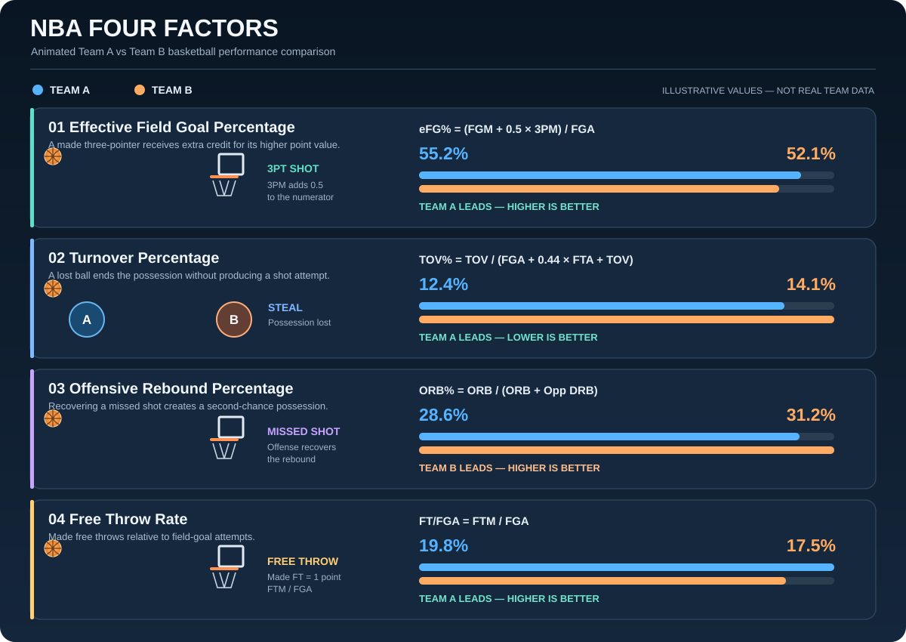

<table>
<tr>
<td width="28%" align="center" valign="middle">

<h1>🎓</h1>

  

<strong>MASTER OF SCIENCE</strong>

  

<strong>BUSINESS ANALYTICS</strong>

  

Isenberg School of Management

  

Class of 2023

</td>
<td width="72%" valign="middle">

<h2>Robert J. Cameron</h2>

<h3>Business Intelligence & Data Analyst</h3>

Business intelligence professional with nearly three years of experience in data integration, reporting, operational analytics, and workflow automation.

I transform fragmented datasets into reliable insights that help businesses improve efficiency, strengthen decision-making, and generate measurable value.

  

</td>
</tr>
</table>

---

## 💼 Professional Experience & Business Impact

### Financial / Data Analyst | Solmetex
**April 2024 – October 2026**

Worked with distributor, customer, and CRM datasets to improve data quality, customer identification, and operational reporting.

| Business Challenge | Solution | Business Impact |
|:---|:---|:---|
| Customer records could not consistently be matched to existing CRM accounts | Developed Python fuzzy-matching and data-standardization workflows | Improved customer identification from approximately **60% to 80–90%** |
| Large volumes of customer records required manual investigation | Analyzed unmatched records and validated customer relationships | Resolved **648 of 877 records (73.9%)** in a targeted review |
| Distributor data was fragmented across separate spreadsheets | Consolidated and standardized **17 distributor workbooks** | Improved cross-distributor analysis and data-quality review |
| Inconsistent customer information complicated reporting | Standardized customer names, addresses, and account relationships | Improved data reliability and reduced manual matching effort |

---

## 🚀 Featured Analytics Projects

### 🏀 01 | NBA Four-Factor Modeling & Team Performance Analytics

**Understanding what drives winning in basketball through statistical analysis.**

The animated dashboard demonstrates how **Dean Oliver's Four Factors** can be used to compare basketball teams across four key performance measures.

Each metric includes a basketball animation illustrating the underlying action, its statistical formula, and a head-to-head comparison between Team A and Team B.

#### The Four Factors Explained

**1. Effective Field Goal Percentage (eFG%) — Shooting Efficiency**

Measures shooting efficiency while accounting for the additional value of three-point field goals.

- The animation illustrates a three-point shot entering the basket.
- A made three-pointer receives an additional 0.5 field-goal credit in the calculation.
- **Higher eFG% indicates better shooting efficiency.**

`eFG% = (FGM + 0.5 × 3PM) / FGA`

**2. Turnover Percentage (TOV%) — Ball Security**

Estimates the percentage of possessions ending in turnovers.

- The animation illustrates a defender taking possession of the basketball.
- Turnovers represent lost scoring opportunities.
- **Lower TOV% indicates better ball security.**

`TOV% = TOV / (FGA + 0.44 × FTA + TOV)`

**3. Offensive Rebound Percentage (ORB%) — Second-Chance Opportunities**

Measures the proportion of available offensive rebounds secured by a team.

- The animation illustrates a missed shot followed by an offensive rebound.
- Recovering missed shots creates additional scoring opportunities.
- **Higher ORB% indicates stronger offensive rebounding performance.**

`ORB% = ORB / (ORB + Opponent DRB)`

**4. Free Throw Rate (FT/FGA) — Free-Throw Production**

Measures made free throws relative to field-goal attempts.

- The animation illustrates a successful free throw.
- The metric captures free-throw scoring production relative to field-goal volume.
- **Higher FT/FGA indicates greater made free-throw production per field-goal attempt.**

`FT/FGA = FTM / FGA`

#### Team A vs. Team B — Overall Comparison

The visualization compares the two teams across all four factors and highlights which team performs better in each category.

| Four Factor | Team A | Team B | Advantage |
|:---|---:|---:|:---|
| Effective FG% | 55.2% | 52.1% | Team A |
| Turnover % | 12.4% | 14.1% | Team A |
| Offensive Rebound % | 28.6% | 31.2% | Team B |
| Free Throw Rate | 19.8% | 17.5% | Team A |
| **Factors Won** | **3 of 4** | **1 of 4** | **Team A** |

**Overall illustrative result:** Team A leads in three of the four statistical categories.

This comparison demonstrates how different dimensions of basketball performance can be evaluated together rather than relying on points scored alone.

The factor count is a descriptive comparison, **not a predicted win probability or a weighted model score**. A predictive model would require historical game data, fitted coefficients, and performance validation.

**Tools:** Python · Pandas · Statistical Analysis · Predictive Modeling

**[Explore NBA Four-Factor Modeling](https://github.com/RobCameron3/nba-four-factor-modeling)**

Team A and Team B statistics are illustrative examples, not actual NBA team results. Basketball animations conceptually demonstrate the statistical formulas.

---

### ⚙️ 02 | Python Customer Identification & Automation

**Transforming fragmented customer records into reliable business intelligence.**

Developed Python-based matching workflows to identify customer accounts across distributor datasets and CRM records.

The workflow demonstrates how incoming customer data moves through several stages:

1. **Data ingestion:** Read incoming distributor records.
2. **Standardization:** Clean and normalize names, addresses, and other identifying fields.
3. **Candidate matching:** Compare records against potential CRM accounts using fuzzy matching.
4. **Validation:** Review similarity scores and verify candidate relationships.
5. **Business outcome:** Improve customer identification and reduce manual investigation.

**Measured professional result:** Increased customer identification from approximately **60% to 80–90%**.

**Tools:** Python · Pandas · Fuzzy Matching · Data Cleaning · CRM Integration

Professional work example. Animation is a conceptual representation of the matching workflow.

---

### 🕵️ 03 | SQL Data Breach Investigation

**Connecting fragmented evidence to identify the responsible record.**

Investigated a simulated data breach using SQL queries to examine records and uncover relationships across datasets.

The animation represents the investigation as a sequence of candidate checks: two incorrect matches are ruled out before the matching record is revealed.

**Analytical methods:**
- SQL joins to connect related records.
- Filtering to narrow potential matches.
- Relational analysis to investigate suspicious activity.
- Query validation to establish the matching relationship.

**Tools:** PostgreSQL · SQL · Joins · Data Investigation

**[Explore SQL Investigation](https://github.com/RobCameron3/sql-data-breach-investigation)**

---

### 📊 04 | Power BI Operational Performance & Logistics

**Turning operational data into actionable KPIs.**

Developed an interactive business intelligence dashboard analyzing operational and commercial performance.

**Analytical focus:**
- Revenue and operational KPI monitoring.
- Shipment and logistics trends.
- Regional performance comparisons.
- Subscription and business activity analysis.
- Interactive filtering and reporting.

**Tools:** Power BI · Power Query · DAX · Data Visualization

**[Explore Operational Logistics Dashboard](https://github.com/RobCameron3/power-bi-operational-logistics-dashboard)**

---

### 🌎 05 | Geographic Density & Trend Analytics

**Understanding where business activity is concentrated.**

Built a Power BI analytics project examining geographic density and trends over time.

The visualization illustrates how regional activity can be compared to identify geographic concentrations and changing patterns.

**Tools:** Power BI · Power Query · DAX · Geographic Analytics

**[Explore Geographic Density Analytics](https://github.com/RobCameron3/power-bi-geographic-density-analytics)**

---

### 📉 06 | Telecommunications Customer Churn Prediction

**Identifying customers who may be at risk of leaving.**

Developed a predictive classification model to analyze customer characteristics and identify potential churn risk.

**Analytical focus:**
- Customer behavior and retention patterns.
- Data preparation and feature analysis.
- Classification modeling.
- Risk segmentation and model evaluation.

**Tools:** Python · Pandas · Classification · Predictive Analytics

**[Explore Telecom Churn Prediction](https://github.com/RobCameron3/Telco_Churn_Prediction)**

---

### 🚗 07 | Used Car Price Prediction

**Estimating vehicle prices using statistical modeling.**

Developed a regression-based analytics project examining the relationship between vehicle characteristics and used-car prices.

**Analytical focus:**
- Data cleaning and exploratory analysis.
- Feature relationships and pricing trends.
- Regression modeling.
- Predicted versus actual price evaluation.

**Tools:** Python · Pandas · Regression · Predictive Modeling

**[Explore Used Car Price Prediction](https://github.com/RobCameron3/Used_Car_Price_Prediction)**

---

## 🛠️ Technical Skills

### Business Intelligence & Reporting

### Programming & Data Analysis

 

### Databases & Enterprise Systems

### Data Integration, Analytics & Automation

---

### Turning Data Into Decisions. Decisions Into Business Value.

