  
  

<table>
<tr>
<td width="32%" align="center" valign="middle">

<h3>MASTER OF SCIENCE</h3>
<strong>BUSINESS ANALYTICS</strong>

Isenberg School of Management

</td>
<td width="68%" valign="middle">
<h2>Robert J. Cameron</h2>
<strong>Business Intelligence &amp; Data Analyst</strong>

Business intelligence professional with nearly three years of experience in data integration, reporting, operational analytics, and workflow automation.

I transform data into reliable insights that improve efficiency, strengthen decision-making, and generate measurable business value.

</td>
</tr>
</table>

## 💼 Professional Experience & Business Impact

<table>
<tr>
<td width="32%" align="center" valign="middle">

<h3>SOLMETEX</h3>
<strong>BUSINESS OPERATIONS ANALYST</strong>

April 2024 – October 2026

</td>
<td width="68%" valign="top">
<h3>Business Intelligence, Automation &amp; Data Integration</h3>

Nearly three years supporting operational analytics, customer data reconciliation, CRM integration, and distributor reporting.

Developed Python-based automation and data-standardization workflows to improve data accuracy, reduce manual processing, and strengthen business reporting.

<strong>Core Technologies</strong>

</td>
</tr>
</table>

 

  <h2>📈 Selected Business Impact</h2>
  
<em>Turning customer data into operational efficiency, better resource allocation, and business opportunities.</em>

<table>
<tr>
<td width="25%" align="center" valign="middle">
<h2>+50%</h2>
<strong>Relative Improvement</strong>
 
Customer identification ~60% to as high as 90%
</td>
<td width="25%" align="center" valign="middle">
<h2>92.5%</h2>
<strong>High-Efficiency Identification</strong>
 
38.1% of analyzed workload
</td>
<td width="25%" align="center" valign="middle">
<h2>82.1%</h2>
<strong>Workload Concentration</strong>
 
Top five distributors
</td>
<td width="25%" align="center" valign="middle">
<h2>84.7%</h2>
<strong>Identification Success</strong>
 
53.6% workload coverage
</td>
</tr>
</table>

<table>
<tr>
<td width="33%" align="center" valign="top">
<h3>⚙️ Operational Efficiency</h3>

Reduced repetitive research, supported backlog reduction, and created capacity for higher-value analytical work.

</td>
<td width="33%" align="center" valign="top">
<h3>🎯 Resource Optimization</h3>

Identified high-performing confidence-score segments to guide research prioritization and workload allocation.

</td>
<td width="34%" align="center" valign="top">
<h3>📈 Business Opportunities</h3>

Improved CRM customer visibility to support targeted sales outreach, customer retention, and potential revenue growth.

</td>
</tr>
</table>

 

---

  <h2>🛠️ Technical Skills</h2>
  
<em>Business intelligence, programming, data integration, and analytical technologies.</em>

<table>
<tr>
<td width="50%" valign="top">

### 📊 Business Intelligence & Reporting

</td>
<td width="50%" valign="top">

### 🐍 Programming & Data Analysis

</td>
</tr>
<tr>
<td width="50%" valign="top">

### 🗄️ Databases & Enterprise Systems

</td>
<td width="50%" valign="top">

### 🔄 Data Integration & Automation

</td>
</tr>
</table>

 

---

  <h2>🚀 Featured Analytics Projects</h2>
  
<em>Applied analytics, automation, and business intelligence across professional and simulated datasets.</em>

<table>
<tr>
<td width="50%" valign="top">
<h3>🏀 01 | NBA Four-Factor Analytics</h3>

<strong>Basketball Performance Modeling</strong>

Applied Dean Oliver's Four Factors framework to evaluate shooting efficiency, turnovers, offensive rebounding, and free-throw production.

<strong>Tools:</strong> Python · Pandas · Statistical Analysis · Predictive Modeling

</td>
<td width="50%" valign="top">
<h3>📊 02 | Customer Intelligence & Automation Strategy</h3>

<strong>Business Intelligence, Workflow Optimization & Decision Support</strong>

Analyzed 877 distributor records, successfully identifying 648 (73.9%). Combined Python, Pandas, advanced Excel, DAX, and Power BI to evaluate customer identification performance, prioritize research workloads, and identify opportunities for automation.

<strong>Key Finding:</strong> A high-efficiency workload segment representing 38.1% of analyzed records achieved a 92.5% customer identification rate.

<strong>Business Value:</strong> Improved CRM data quality, reduced repetitive research, and supported more targeted sales outreach opportunities.

<strong>Tools:</strong> Python · Pandas · Excel · Power Pivot · DAX · Power BI · Dynamics 365 CRM

</td>
</tr>
<tr>
<td width="50%" valign="top">
<h3>🕵️ 03 | SQL Data Breach Investigation</h3>

<strong>Relational Data Investigation</strong>

Investigated a simulated data breach using SQL joins, filtering, and relational analysis to uncover relationships between records.

<strong>Tools:</strong> PostgreSQL · SQL · Joins · Data Investigation

</td>
<td width="50%" valign="top">
<h3>📊 04 | Operational Logistics Dashboard</h3>

<strong>Meal-Kit Subscription & Delivery Analytics</strong>

Built a Power BI dashboard analyzing subscription demand, revenue performance, shipment volumes, and regional operational KPIs.

<strong>Tools:</strong> Power BI · Power Query · DAX · Forecasting

</td>
</tr>
<tr>
<td colspan="2" valign="top">
<h3>🌎 05 | Geographic Density & Trend Analytics</h3>

<strong>Regional Concentrations & Historical Trend Analysis</strong>

Built an interactive Power BI dashboard to examine geographic concentrations, regional activity, seasonal distributions, and long-term trends.

<strong>Tools:</strong> Power BI · Power Query · DAX · Geographic Analytics

</td>
</tr>
</table>

 

  <strong>Turning Data Into Decisions. Decisions Into Business Value.</strong>

